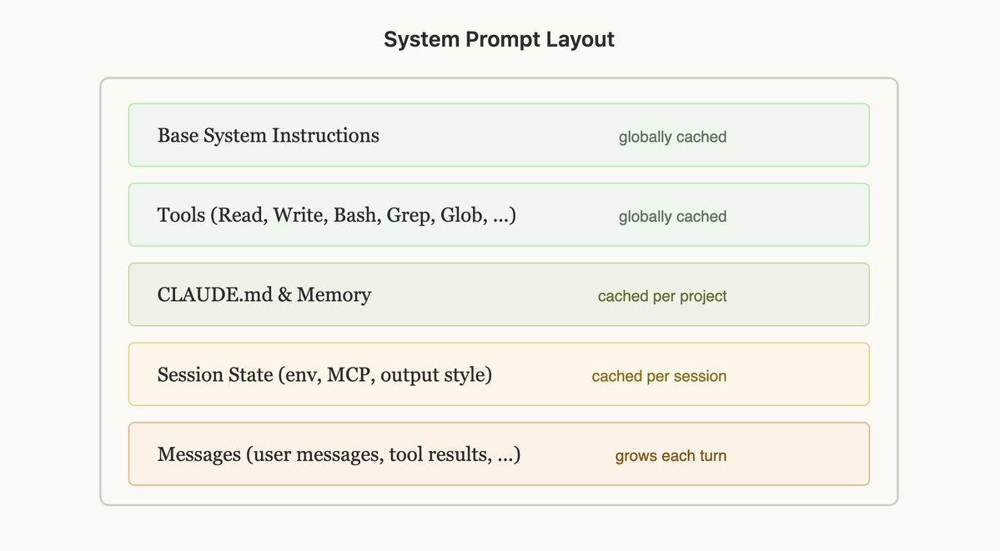
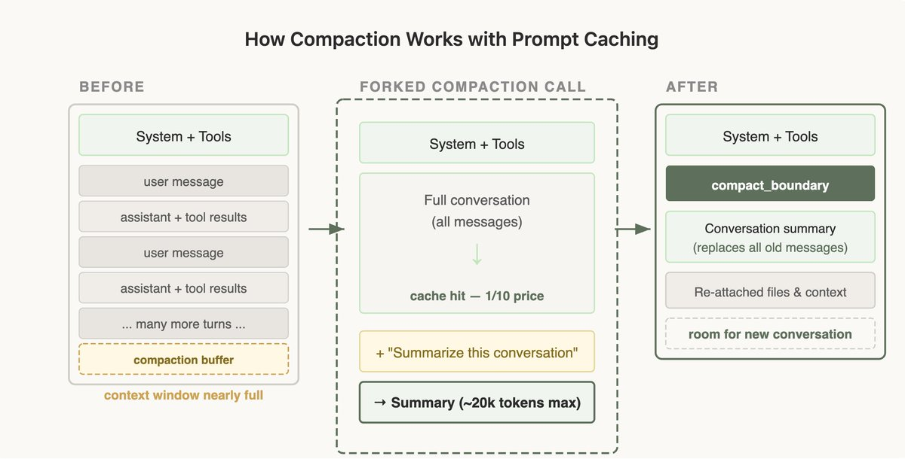

# 从构建Claude Code中汲取的经验教训：提示缓存至关重要

翻译自[Lessons from Building Claude Code: Prompt Caching Is Everything ](https://x.com/trq212/status/2024574133011673516)

工程学中常说“缓存决定一切”，这条规则同样适用于代理。

像 Claude Code 这样的长时间运行的代理产品之所以可行，是因为有了及时缓存，我们可以重用以前往返的计算结果，从而显著降低延迟和成本。
什么是提示缓存？它是如何工作的？如何从技术上实现它？请阅读 @RLanceMartin 关于提示缓存和我们新推出的自动缓存功能的文章，了解更多信息。

在 Claude Code，我们整个系统都围绕提示缓存构建。较高的提示缓存命中率可以降低成本，并帮助我们为订阅计划设定更宽松的速率限制，因此我们会监控提示缓存命中率，并在命中率过低时发出严重事件警报 (SEV)。

以下是我们从大规模优化提示缓存中学到的（通常不符合直觉的）经验教训。

## 规划缓存提示

提示缓存的工作原理是前缀匹配——API 会缓存从请求开始到每个 cache_control 断点之间的所有内容。这意味着请求的顺序至关重要，您应该尽可能让多个请求共享同一个前缀。
最佳做法是先添加静态内容，最后添加动态内容。对于 Claude Code 来说，这看起来像这样：
* 静态系统提示符和工具（全局缓存）
* Claude.MD （缓存于项目内）
* 会话上下文（缓存于会话中）
* 对话消息  

这样可以最大限度地增加共享缓存命中次数的会话数量。

但这种机制可能非常脆弱！我们之前破坏这种排序的原因包括：在静态系统提示符中放置详细的时间戳、不确定地打乱工具顺序定义、更新工具的参数（例如 AgentTool 可以调用哪些代理）等等。

## 使用消息进行更新
有时，您在提示信息中输入的内容可能会过时，例如当您没有时间更新，或者用户更改了文件时。您可能很想更新提示信息，但这会导致缓存未命中，最终可能会给用户带来相当大的开销。

考虑是否可以在下一轮中通过消息传递此信息。在 Claude Code 中，我们会在下一条用户消息或工具结果中添加一个 `<system-reminder>` 标签，其中包含模型的更新信息（例如，现在是星期三），这有助于保留缓存。

## 不要在会话中途更改模型
提示缓存是特定模型独有的，这使得提示缓存的数学计算相当反直觉。

如果你已经和 Opus 进行了 10 万次对话，并且想问一个很容易回答的问题，那么切换到 Haiku 实际上会比让 Opus 回答更昂贵，因为我们需要重建 Haiku 的提示缓存。

如果需要切换模型，最佳方法是使用子代理，Opus 会准备一条“交接”消息，将需要完成的任务传递给另一个模型。我们在 Claude Code 中使用 Haiku 的 Explore 代理时经常这样做。

## 切勿在会话期间添加或删除工具
在对话过程中更改工具集是破坏提示缓存最常见的方式之一。这看似合乎直觉——你应该只给模型提供它当前需要的工具。但由于工具是缓存前缀的一部分，添加或删除工具会使整个对话的缓存失效。

## 规划模式——围绕缓存进行设计
计划模式是围绕缓存限制设计功能的一个很好的例子。直观的做法是：当用户进入计划模式时，将工具集替换为仅包含只读工具。但这会破坏缓存。

相反，我们始终将所有工具保留在请求中，并将 EnterPlanMode 和 ExitPlanMode 本身用作工具。当用户启用计划模式时，代理会收到一条系统消息，说明其已处于计划模式以及相应的指令——浏览代码库、不要编辑文件、在计划完成后调用 ExitPlanMode。工具定义始终保持不变。

这还有一个额外的好处：因为 EnterPlanMode 是模型可以调用自身的一个工具，所以当它检测到难题时，它可以自主进入计划模式，而不会中断缓存。

## 工具搜索 — 延迟删除
同样的原理也适用于我们的工具搜索功能。Claude Code 可以加载数十个 MCP 工具，如果每次请求都包含所有工具，开销会很大。但如果在对话过程中移除这些工具，又会破坏缓存。

我们的解决方案：延迟加载。我们不会移除工具，而是发送轻量级的工具存根——仅包含工具名称，并将 `defer_loading: true` 设置为 true——模型可以在需要时通过 `ToolSearch` 工具“发现”这些存根。完整的工具架构仅在模型选择它们时才会加载。这样可以保持缓存前缀的稳定性：相同的存根始终以相同的顺序存在。

幸运的是，你可以使用工具搜索通过我们的 API 工具简化此过程。

## 分叉上下文 — 压缩

当上下文窗口超出范围时，就会发生压缩。我们会总结目前为止的对话内容，并使用该总结结果继续新的会话。

令人惊讶的是，压缩在即时缓存方面有很多特殊情况，这可能不太直观。

具体来说，当我们进行压缩时，需要将整个对话发送给模型以生成摘要。如果这是一个单独的 API 调用，带有不同的系统提示且未使用任何工具（这是最简单的实现方式），则主对话中缓存的前缀将完全不匹配。用户需要为所有这些输入令牌支付全额费用，从而大幅增加成本。

### 解决方案——缓存安全分叉

执行压缩操作时，我们使用与父会话完全相同的系统提示符、用户上下文、系统上下文和工具定义。我们会将父会话的消息添加到压缩提示符之前，然后在末尾添加新的用户消息。

从 API 的角度来看，这个请求几乎与父级请求的最后一个请求完全相同——相同的前缀、相同的工具、相同的历史记录——因此缓存的前缀被重用。唯一的新标记是压缩提示本身。

但这意味着我们需要保存一个“压缩缓冲区”，以便在上下文窗口中有足够的空间来包含压缩消息和摘要输出标记。

压缩很棘手，但幸运的是，你不需要自己去学习这些经验——基于我们从 Claude Code 那里学到的知识，我们构建了压实直接集成到 API 中，因此您可以将这些模式应用到您自己的应用程序中。

## 经验教训

* 提示缓存采用前缀匹配。前缀中任何位置的更改都会使该位置之后的所有内容失效。请围绕此约束设计您的整个系统。只要顺序正确，大部分缓存功能就能免费发挥作用。
* 使用消息而不是修改系统提示。您可能想通过编辑系统提示来执行诸如进入计划模式、更改日期等操作，但实际上最好在对话过程中将这些操作插入到消息中。
* 不要在对话过程中切换工具或模型。使用工具来模拟状态转换（例如计划模式），而不是更改工具集。延迟加载工具，而不是移除工具。
* 像监控正常运行时间一样监控缓存命中率。我们会对缓存中断发出警报，并将其视为事件进行处理。即使缓存未命中率只有几个百分点，也会对成本和延迟产生显著影响。
* 分支操作需要共享父进程的前缀。如果需要运行额外的计算（例如压缩、摘要、技能执行），请使用相同的缓存安全参数，以便缓存能够命中父进程的前缀。
Claude Code 从一开始就围绕提示缓存构建，如果你要构建代理，你也应该这样做。